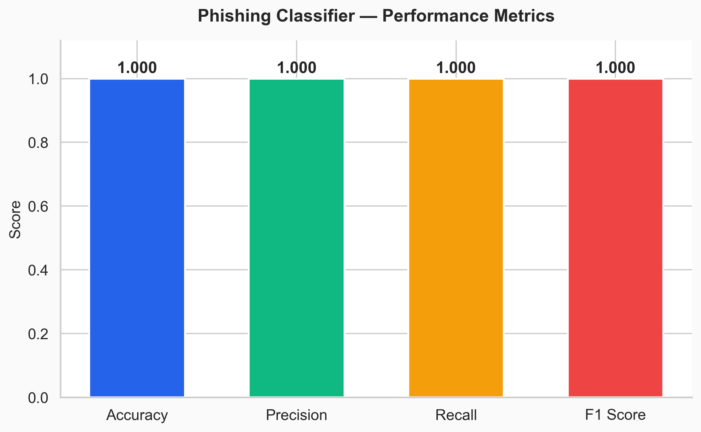
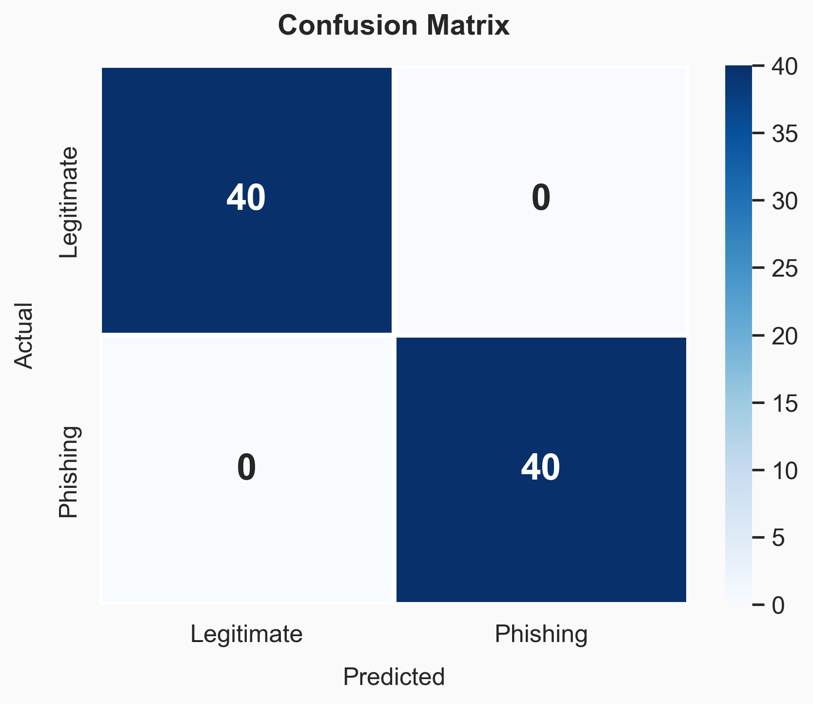
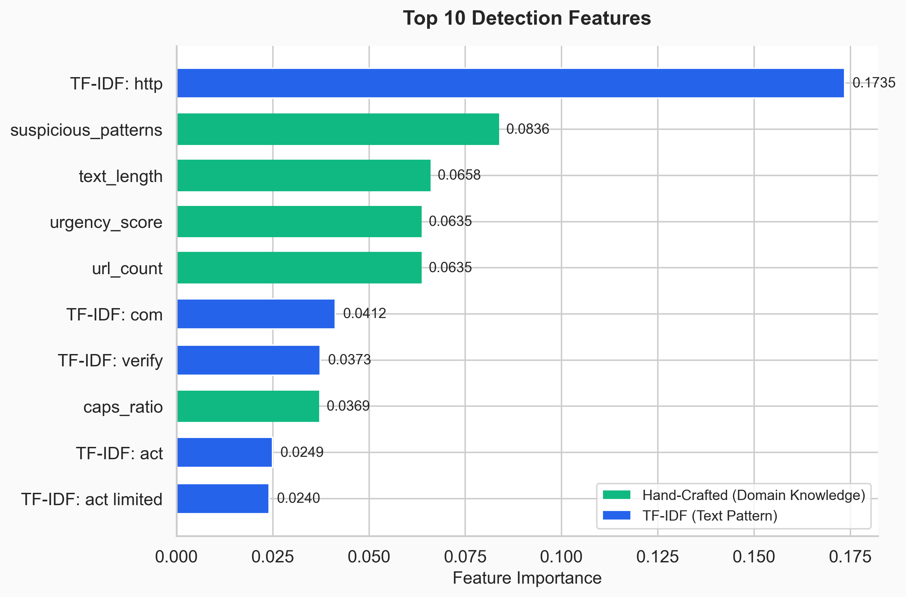
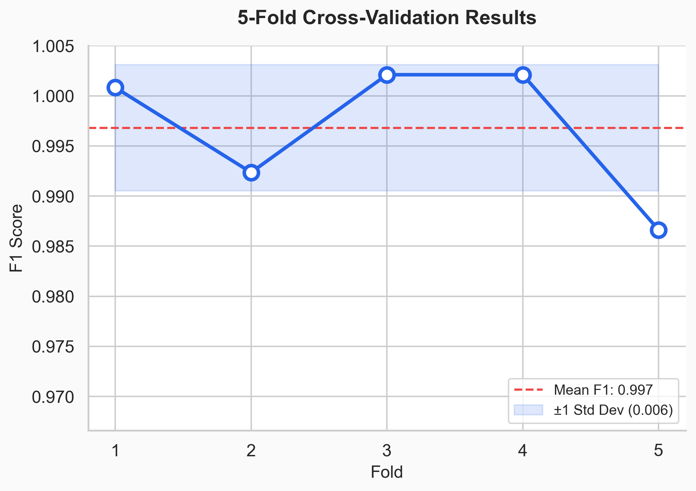
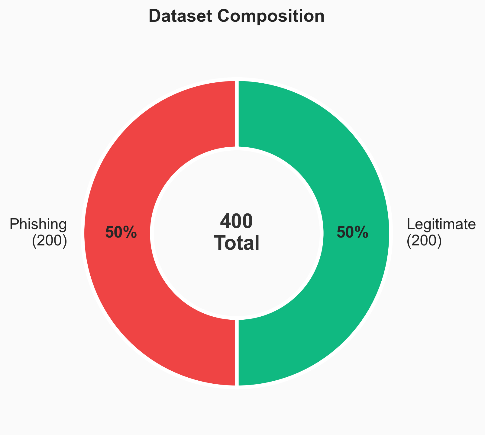

# Phishing Email Classifier

A machine learning pipeline that classifies emails as **phishing** or **legitimate** using text-based feature extraction and a Random Forest classifier.

## Goal

Demonstrate the ability to build an end-to-end ML pipeline for a cybersecurity use case: detecting phishing emails through feature engineering, model training, and evaluation.

## Tools & Technologies

- **Python 3.10+**
- **scikit-learn** — TF-IDF vectorization, Random Forest classifier, cross-validation
- **pandas / NumPy** — Data manipulation and numerical operations
- **matplotlib / seaborn** — Charts
- **Re (regex)** — Pattern matching for suspicious URLs, PII requests, typosquatting

## Architecture

```
Email Text
    │
    ├──► Hand-Crafted Features (7 features)
    │       • Urgency keyword score
    │       • Suspicious URL pattern count
    │       • URL count
    │       • Uppercase character ratio
    │       • Exclamation mark count
    │       • Text length
    │       • Monetary reference flag
    │
    ├──► TF-IDF Features (200 features)
    │       • Unigrams and bigrams
    │       • English stop words removed
    │
    └──► Combined Feature Vector (207 features)
              │
              ▼
        Random Forest Classifier (100 trees)
              │
              ▼
        Prediction: PHISHING or LEGITIMATE
        + Confidence Score
```

## How to Run

```bash
# Install dependencies
pip install -r requirements.txt

# Run the full pipeline
python phishing_classifier.py

# Generate visualizations (run after the classifier)
python visualize_results.py
```

This will:
1. Generate a synthetic dataset of 400 emails (200 phishing, 200 legitimate)
2. Extract hand-crafted + TF-IDF features
3. Train a Random Forest classifier with 80/20 train/test split
4. Run 5-fold cross-validation
5. Print evaluation metrics and top features
6. Demonstrate classification on 5 new unseen emails
7. Save results to `results/evaluation_results.json`
8. Generate professional visualizations in `screenshots/`

## Results

On the committed synthetic dataset (400 emails, 200 phishing / 200 legitimate; `results/evaluation_results.json`), scored on the 80-email held-out test set:

| Metric    | Score |
|-----------|-------|
| Accuracy  | 1.00 |
| Precision | 1.00 |
| Recall    | 1.00 |
| F1 Score  | 1.00 |
| 5-fold CV F1 | 0.9968 ± 0.0063 |

A perfect test score on synthetic, template-generated email means the task is too easy, not that the model is production-ready. The next step is a real corpus (see Limitations). Rerunning the pipeline regenerates these files.

## Visualizations

### Performance Metrics


### Confusion Matrix


### Top Detection Features


### Cross-Validation Stability


### Dataset Composition


## Key Features Detected

The classifier learns to identify phishing signals including:
- **Urgency language** ("act now", "immediately", "expires")
- **Suspicious URLs** (IP-based links, typosquatted domains, sketchy TLDs)
- **ALL CAPS text** (common phishing tactic)
- **PII solicitation** (requests for SSN, bank details, passwords)
- **Monetary references** (fake charges, prize amounts)

## Limitations

- **Synthetic dataset**: Uses generated emails rather than a real-world corpus. Production deployment would require training on actual phishing/legitimate email datasets (e.g., Nazario corpus, IWSPA).
- **No header analysis**: Real phishing detection also examines email headers (SPF, DKIM, sender reputation). This project focuses on body text only.
- **Limited adversarial robustness**: Sophisticated phishing that mimics legitimate tone may evade detection. Adversarial testing was not performed.
- **Class balance assumption**: The 50/50 split does not reflect real-world distribution where phishing is a smaller percentage of total email volume.
- **No deployment pipeline**: This is a batch analysis tool, not a real-time email filter.

## Lessons Learned

1. **Feature engineering matters**: Hand-crafted features (urgency score, suspicious URL patterns) provided strong signal alongside TF-IDF, demonstrating that domain knowledge improves ML model performance.
2. **Evaluation beyond accuracy**: Using precision, recall, and F1 gives a more complete picture — in phishing detection, recall (catching all phishing) often matters more than precision.
3. **Documentation is part of the work**: Clearly documenting limitations and assumptions demonstrates professional maturity and honest technical assessment.

## Author

Mahmoud Al Kurdi — [LinkedIn](https://www.linkedin.com/in/mahmoud-al-kurdi-it/) | [GitHub](https://github.com/KM-it-ops) | CompTIA Security+ | B.S. Information Technologies (Cybersecurity), SNHU | [Portfolio](https://km-it-ops.github.io/)
